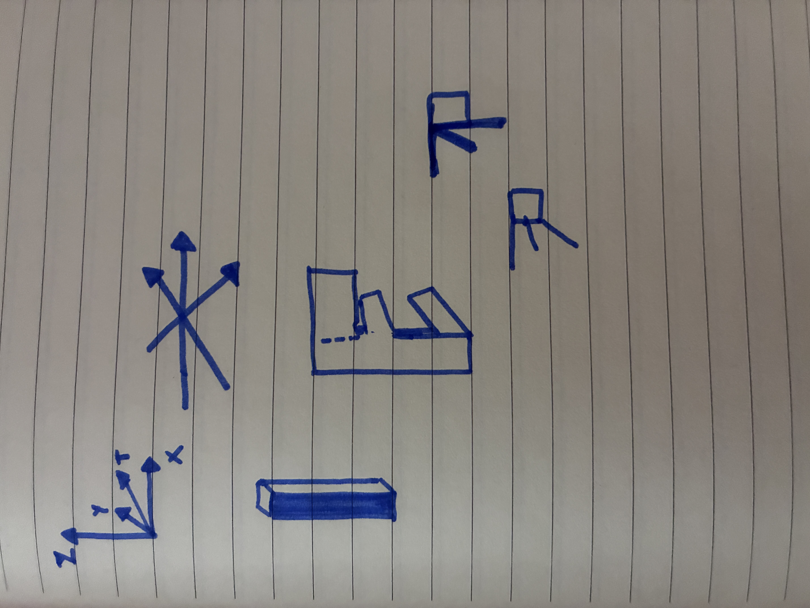

# How I Made This Letterform

## From box to letter

1. First I chose old cardboard box that was on my desk, from a recently purchased face cream.
2. Then I chose one side, tore it into 3 stripes and bend them into 3 different directions.
3. I created a 3 dimensional letter E, that is readable from more than 1 direction as it is for flat 2D letter.  

## Haiku drafts

First draft:  
No purpose left to serve  
Yet I gave it one more life  
And taught it how to speak

[The finished Letterform and Haiku](index.md)
